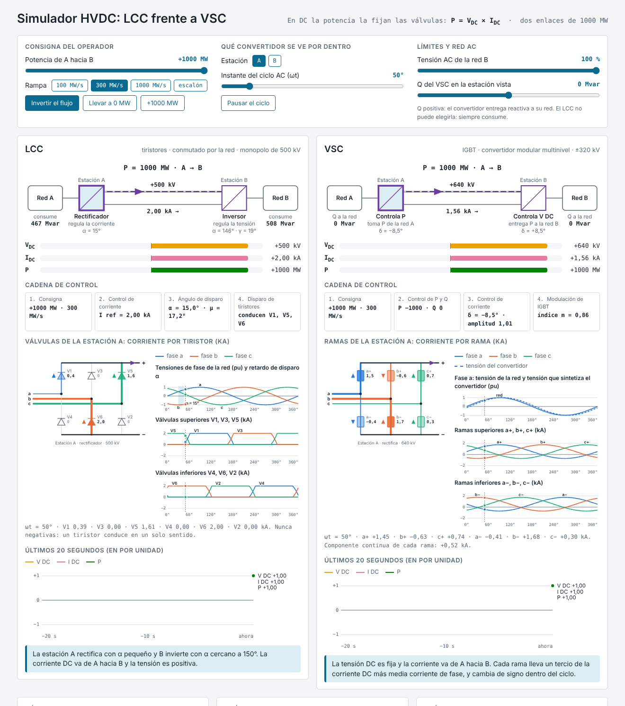

# Simulador HVDC: LCC frente a VSC

Simulador interactivo que compara las dos tecnologías de convertidor HVDC y muestra qué ocurre en sus válvulas mientras se invierte el flujo de potencia.

**[Abrir el simulador](https://ajrcjf-web.github.io/hvdc-lcc-vs-vsc-simulator/)** · **[Leer la guía de conceptos (PDF)](https://ajrcjf-web.github.io/hvdc-lcc-vs-vsc-simulator/docs/LCC_y_VSC_conceptos.pdf)**



## Objetivo

Un enlace HVDC es controlable porque está interrumpido por convertidores de electrónica de potencia. La potencia no la reparte la red: la fijan las válvulas.

```
P_DC = V_DC × I_DC
```

Una estación fija la tensión DC y la otra regula la corriente o la potencia. Las dos tecnologías invierten el flujo de forma opuesta:

- **LCC** (tiristores): la corriente DC solo circula en un sentido; se invierte la polaridad de la tensión.
- **VSC** (IGBT): la tensión DC se mantiene; se invierte el sentido de la corriente.

El simulador hace visible esa diferencia hasta el nivel de la corriente de cada válvula y de cada rama.

## Qué incluye

| Archivo | Contenido |
|---|---|
| `index.html` | El simulador completo en un solo archivo. No requiere instalación ni servidor. |
| `docs/LCC_y_VSC_conceptos.pdf` | Guía de 7 páginas: conceptos, comparación, cadena de control, límites y usos del simulador. |

## Funcionamiento básico

Dos enlaces de 1000 MW reciben la misma consigna: un LCC monopolar de 500 kV y 2 kA, y un VSC modular multinivel de ±320 kV.

Controles comunes:

| Control | Para qué sirve |
|---|---|
| Consigna de potencia y rampa | Fijar MW y sentido; botones para invertir el flujo, ir a 0 MW o a +1000 MW |
| Estación A o B | Elegir qué convertidor se ve por dentro |
| Instante del ciclo AC | Recorrer a mano los 360° eléctricos, o reproducirlos en cámara lenta |
| Tensión AC de la red B | Debilitar una red para ver los límites de cada tecnología |
| Q del VSC | Pedir potencia reactiva al convertidor visto |

Cada columna muestra:

1. **Esquema del enlace:** tensión, corriente, potencia, papel de cada estación y reactiva.
2. **V × I = P:** tres barras con signo. En el LCC cambia de lado la tensión; en el VSC, la corriente.
3. **Cadena de control:** consigna, referencia, control interno y disparo, con sus valores.
4. **Puente del convertidor:** corriente instantánea de las seis válvulas (LCC) o las seis ramas (VSC).
5. **Formas de onda sobre un ciclo:** válvulas superiores e inferiores, con cursor.
6. **Últimos 20 segundos:** evolución de tensión, corriente y potencia durante la rampa.

### Modelo

- **LCC:** puente de 6 pulsos. Tensión del puente `V = Vdi0 · (u·cos α − dx·I)`, solapamiento μ de `cos(α+μ) = cos α − 2·dx·I/u` y margen de extinción `γ = 180° − α − μ`. Límites α ≥ 5° y γ ≥ 15°. Corriente mínima del 10 %.
- **VSC:** convertidor modular multinivel. Corriente de rama `i = I_DC/3 ± i_fase/2`. La tensión sintetizada sale de `Vc = Vred − jX·I`, con X = 0,15 pu. Límite de corriente de 1,1 pu.

## Consideraciones y límites

- **Es una herramienta didáctica, no de estudio.** Los parámetros son ilustrativos.
- **Régimen permanente.** Calcula puntos de operación que siguen la rampa; no simula lazos de control, transitorios ni fallas.
- **La inversión del LCC está idealizada.** Un LCC real reduce la potencia, espera y arranca en sentido contrario. Aquí el recorrido es continuo para que se vea la relación entre variables.
- **Seis pulsos.** Los enlaces LCC reales usan puentes de 12 pulsos y, a menudo, dos polos.
- **MMC simplificado.** Sin submódulos individuales, corrientes circulantes ni rizado de condensadores.
- **Sin armónicos, filtros, pérdidas de convertidor ni cambiadores de tomas.**

## Uso local

Descarga `index.html` y ábrelo en cualquier navegador moderno. Necesita conexión solo para cargar las tipografías; sin ella funciona igual con las del sistema.

## Proyecto relacionado

[Simulador de flujo de potencia AC](https://github.com/ajrcjf-web/ac-power-flow-simulator): por qué en una red AC la potencia se reparte sola y cómo un enlace HVDC cambia eso.

## Créditos

Desarrollado con asistencia de Claude (Anthropic).

## Licencia

MIT. Ver [LICENSE](LICENSE).
